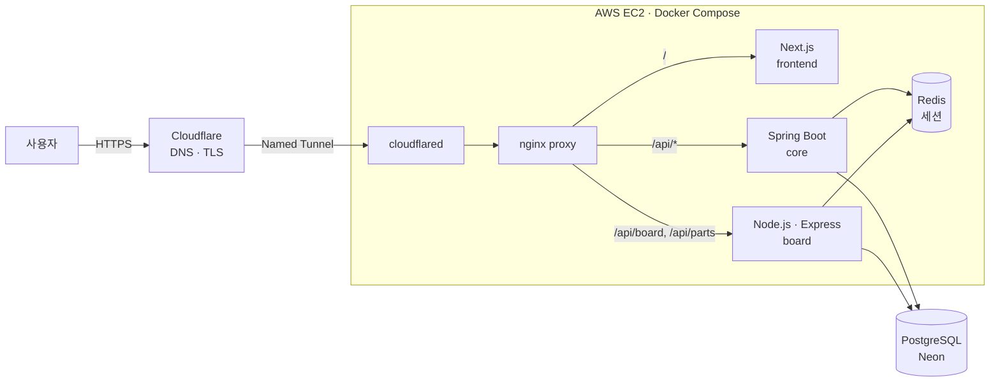

# morethancar

> 차를 "타는 것" 이상으로 즐기는 오너들을 위한 자동차 커뮤니티 — **[morethancar.kr](https://morethancar.kr)**

내 차를 등록·인증하고, 그 차로 글을 쓰고, 부품을 사고팔고, 드라이브 코스와 모터스포츠 일정을 찾는 서비스입니다.
기획부터 백엔드·프론트엔드·인프라·운영까지 혼자 맡아 **실제 도메인으로 운영 중**입니다.

| 기간 | 형태 | 역할 |
|---|---|---|
| 2026.09 ~ 운영 중 | 개인 프로젝트 (실서비스) | 기획 · 설계 · 백엔드 · 프론트엔드 · 인프라 · 운영 |

---

## 주요 기능

| 영역 | 내용 |
|---|---|
| **Garage** | 차량 프로필 등록, 등록증 기반 차량 인증(관리자 승인/반려), 튜닝·정비 기록 |
| **Community** | 게시글·댓글·대댓글, 이미지 첨부, 신고, 인증 차량 오너 인장 표시 |
| **Parts** | 회원 간 중고 부품 직거래 장터(판매 상태·관심 매물) |
| **Spots** | 와인딩·드라이브 스팟 제보와 승인, 카카오 지도 표시 |
| **Motorsport** | 공식 출처 기반 경기·스포츠주행 일정 캘린더(KST·현지 시각 병기) |
| **EV** | 전기차 정책·혜택 허브. 공식 기관 자료로 확인한 정책만 버전 단위로 공개 |
| **Admin** | 회원·게시글·신고 처리, 차량 인증, 스팟·일정·EV 정책 관리 |
| **Account** | 아이디/비밀번호·카카오 로그인, 비밀번호 재설정 메일, 회원 탈퇴 |

## 아키텍처



| 서비스 | 기술 | 담당 |
|---|---|---|
| `frontend/` | Next.js(App Router) · React · TypeScript | 화면, SSR, SEO(sitemap·robots·JSON-LD) |
| `backend/` (core) | Java 23 · Spring Boot 3.5 · JPA · Flyway | 회원·인증·카카오 OAuth·차량·차량 인증, **DB 스키마 소유** |
| `board-service/` (board) | Node.js 22 · Express 5 · pg | 커뮤니티·장터·스팟·모터스포츠·EV·관리자 API |
| `nginx/` | nginx | 단일 진입점, 경로 라우팅, rate limit, 보안 헤더 |
| 데이터 | PostgreSQL 16(Neon) · Redis 7 | 영속 데이터 / 두 API 서버가 공유하는 세션 |
| 인프라 | Docker Compose · Cloudflare Tunnel · GitHub Actions | 배포, 외부 노출, CI |

## 기술적으로 고민한 것

### 1. 두 언어의 API 서버가 하나의 로그인을 공유
인증은 Spring(core), 커뮤니티는 Node(board)가 맡습니다. 로그인 시 core가 Redis에 세션을 만들고
`HttpOnly`·`SameSite=Lax` 쿠키를 내려 주면, board는 같은 Redis 세션을 읽어 사용자를 확인합니다.
관리자 API는 세션의 role만 믿지 않고 **요청마다 DB에서 관리자 권한을 다시 확인**합니다.

### 2. 스키마는 한 곳에서만 바꾼다
두 서버가 같은 DB를 쓰기 때문에 DDL 소유자를 core의 Flyway 하나로 정했습니다(`V1`~`V9`).
board는 DDL을 실행하지 않습니다. 운영 DB에 마이그레이션하기 전에는 일회용 PostgreSQL에서
신규 적용(V1→최신)과 기존 버전 업그레이드를 모두 실행해 보고, `pg_dump` 백업·복원까지 확인했습니다.

### 3. 열린 포트가 없는 운영 서버
외부 진입은 Cloudflare Named Tunnel 하나뿐이라 호스트에 공개 포트가 없습니다.
Docker가 게시한 포트는 호스트 방화벽을 우회하기 때문에, 운영 오버레이(`docker-compose.prod.yml`)에서
proxy의 포트 게시 자체를 제거했습니다. 컨테이너 네트워크도 역할별로 나눠(`edge`/`app`/`data`/`tunnel`)
frontend는 Redis에 닿지 않고 Redis는 외부와 통신하지 못합니다. 필수 환경변수가 없으면 기동 자체가 실패하도록 해
로컬용 약한 기본값이 운영에 섞이지 않게 했습니다.

### 4. 여러 겹의 방어
- nginx: API 전체·인증 경로별 rate limit, CSP·HSTS·nosniff 등 보안 헤더, Cloudflare 경유 연결만 실제 IP 복원
- core: 로그인 시도 제한, 요청 본문 크기 제한, BCrypt 해싱(기존 평문 비밀번호는 기동 시 자동 전환), 카카오 OAuth `state` 검증
- board: 파라미터 바인딩 SQL, `sanitize-html`로 본문 정제, 이미지는 공개 데이터가 참조할 때만 공개
- 신고 처리·EV 정책 승격처럼 동시에 눌릴 수 있는 작업은 조건부 원자 업데이트로 중복 처리를 `409`로 막음

### 5. 모터스포츠 일정 자동 수집 — "정확함"과 "운영자 통제" 우선
F1·NASCAR·르망 24시·슈퍼레이스·인제 스피디움 출처 어댑터를 만들었습니다. ([상세](docs/MOTORSPORT-IMPORT.md))
- 수집 결과는 항상 **초안(DRAFT)**. 공개는 운영자가 확인한 뒤에만 합니다.
- 출처 식별자(`source_key`)로 같은 일정을 찾아 재실행해도 중복이 생기지 않고, 출처별 DB 잠금 + `flock`으로 동시 실행을 막습니다.
- 운영자가 고친 값은 덮어쓰지 않고 "재확인 대기열"로 보냅니다. 출처에서 사라졌다고 삭제하지도 않습니다.
- 시각은 출처가 확정한 것만 UTC로 저장하고, 날짜는 개최지 현지 날짜로 저장합니다.
- 각 출처의 이용약관을 직접 확인해 **금지·불명확한 출처는 기본 비활성화**했습니다. 요청을 막는 사이트(WRC)는 우회하지 않았습니다.

### 6. 검증 가능한 데이터만 공개 (EV 허브)
정책 정보는 틀리면 사용자에게 손해가 됩니다. 정책을 버전 단위로 관리하고, 법령 원문·운영기관 공지로
시행일·한도·종료일을 확인한 항목만 공개했습니다. 목표 개수를 채우기보다 확인되지 않은 항목은 보류했습니다.

## 품질 관리

- **CI**: GitHub Actions에서 push/PR마다 Spring 테스트(PostgreSQL·Redis 서비스 컨테이너로 통합 테스트 포함)와 Node 테스트 실행
- **시스템 테스트**: `scripts/`의 시나리오 스크립트로 실제 컨테이너 스택에 HTTP 요청을 보내 커뮤니티·장터·관리자·탈퇴 흐름 확인
- **헬스체크**: 모든 서비스에 healthcheck와 의존 순서를 두고 `up --wait`로 배포 성공 여부 판단
- **작업 기록**: 기능마다 원인·결정·검증 결과를 `docs/`에 남김

## 프로젝트 구조

```
morethancar/
├── frontend/          # Next.js 운영 화면
├── backend/           # Spring Boot core API + Flyway 마이그레이션
├── board-service/     # Node.js board API
│   └── src/motorsport-import/   # 모터스포츠 일정 수집기(출처 어댑터·반영 규칙·CLI)
├── nginx/             # proxy 설정
├── scripts/           # 시스템 테스트, cron, 점검 스크립트
├── docs/              # 기능별 설계·결정·검증 기록
├── docker-compose.yml        # 로컬 전체 스택
├── docker-compose.dev.yml    # 개발용 DB 오버레이
└── docker-compose.prod.yml   # 운영 오버레이(Neon, Cloudflare Tunnel, 네트워크 분리)
```

<details>
<summary><b>로컬에서 실행하기</b></summary>

```sh
cp .env.example .env
docker compose up -d --build --wait   # http://localhost:8090

# 테스트
cd backend && mvn test
cd board-service && npm test
```

</details>

## 문서

| 주제 | 문서 |
|---|---|
| 모터스포츠 일정 수집 | [docs/MOTORSPORT-IMPORT.md](docs/MOTORSPORT-IMPORT.md) |
| DB 마이그레이션 | [docs/DATABASE-MIGRATIONS.md](docs/DATABASE-MIGRATIONS.md) |
| 관리자 기능 | [docs/ADMIN-OPERATIONS.md](docs/ADMIN-OPERATIONS.md) |
| 부품 장터 | [docs/PARTS-MARKET.md](docs/PARTS-MARKET.md) |
| 회원 탈퇴 | [docs/member-withdrawal.md](docs/member-withdrawal.md) |
| 비밀번호 재설정 | [docs/member-management-password-reset.md](docs/member-management-password-reset.md) |
| 모터스포츠·스팟 기획 | [docs/plans/MOTORSPORT-AND-SPOTS-PLAN.md](docs/plans/MOTORSPORT-AND-SPOTS-PLAN.md) |
| Docker 과제 기록 | [ASSIGNMENT.md](ASSIGNMENT.md), [docs/DOCKER-SUBMISSION.md](docs/DOCKER-SUBMISSION.md) |

> 일부 `docs/` 문서는 Next.js 이전 전의 레거시 HTML 프론트엔드 기준 기록입니다. API·운영 내용은 현재도 유효합니다.
